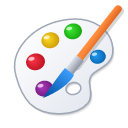
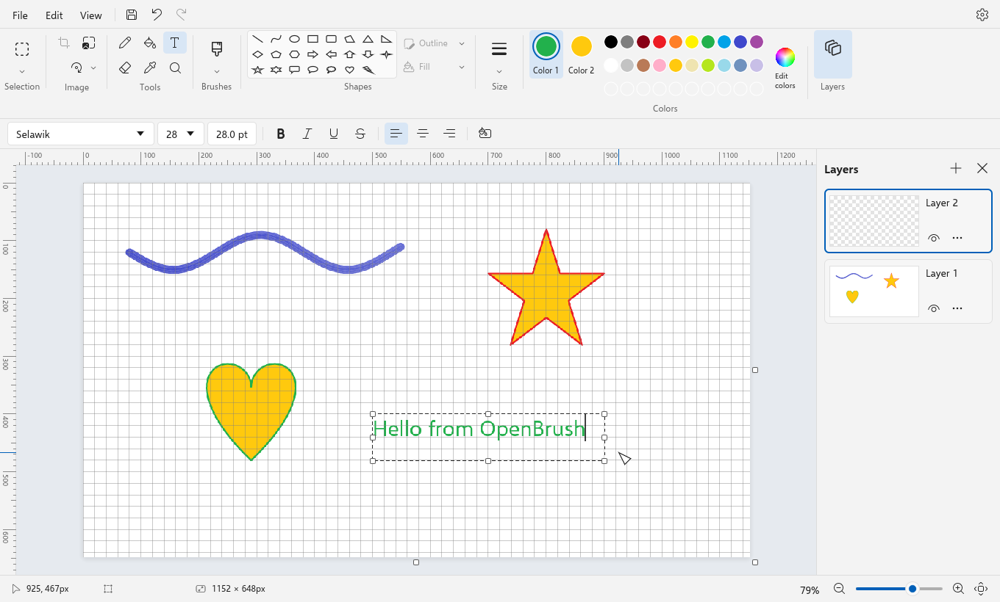
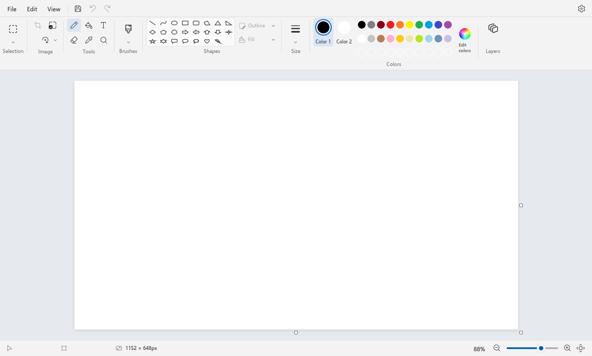
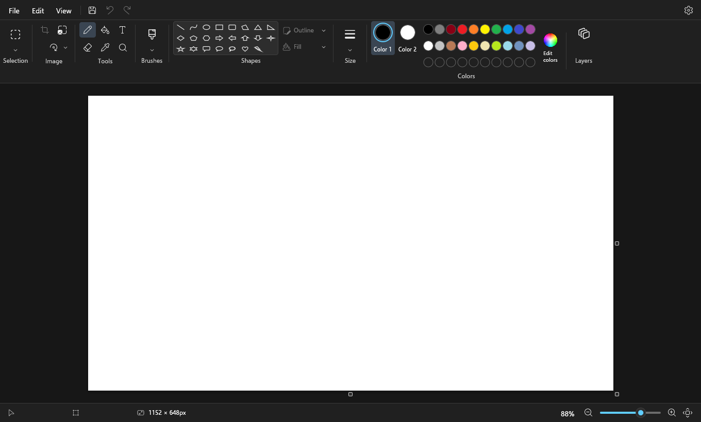
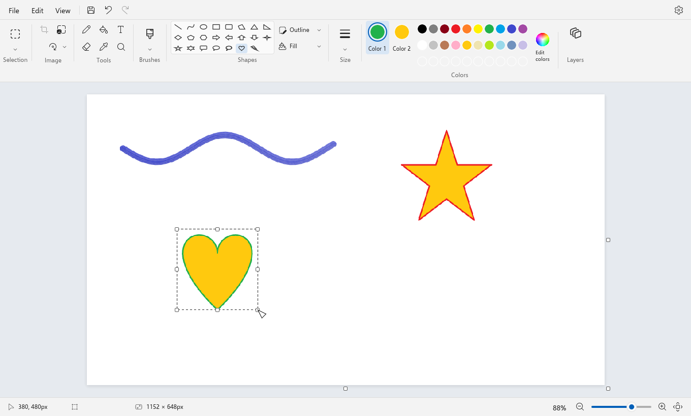
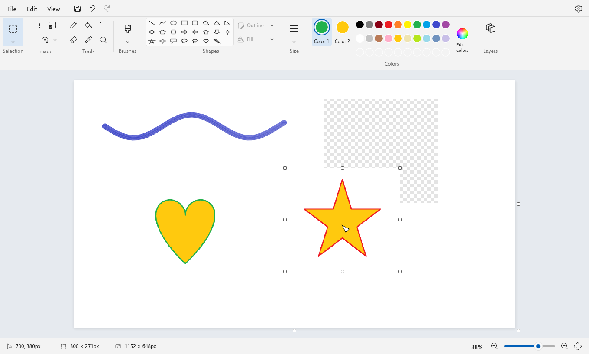
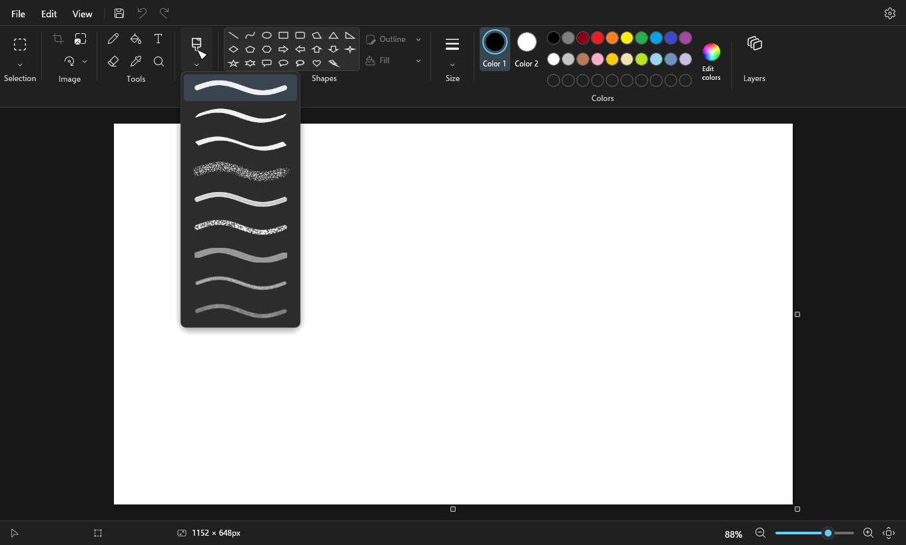
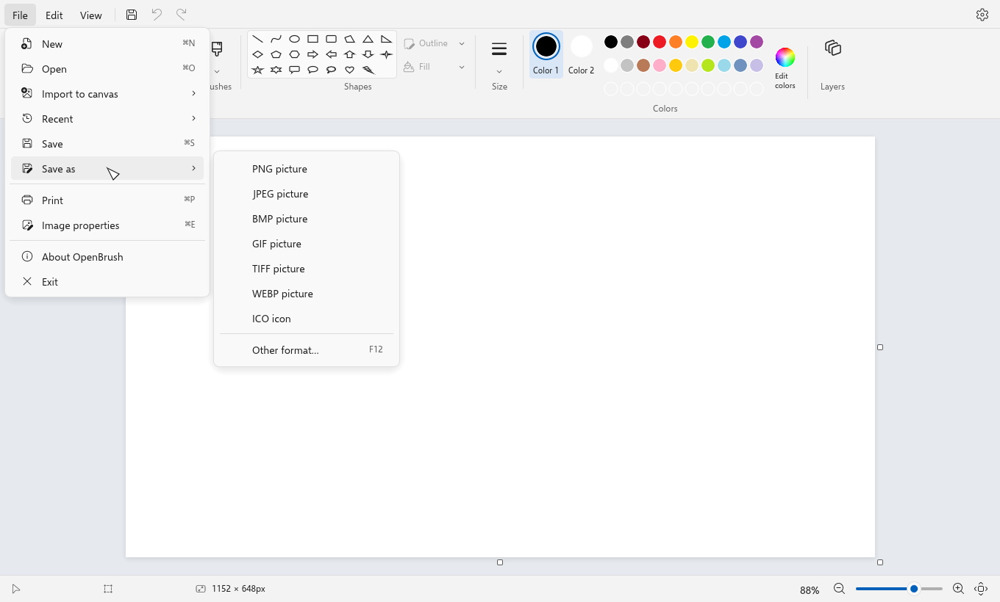
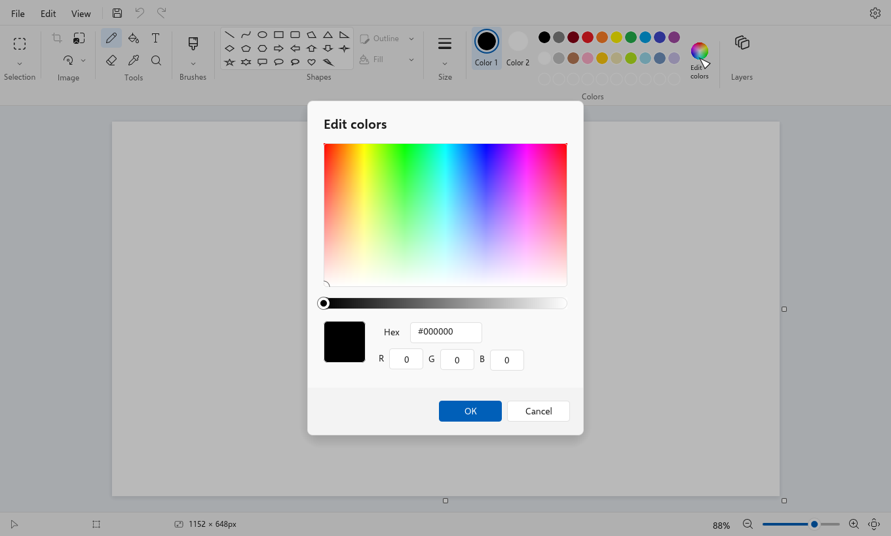
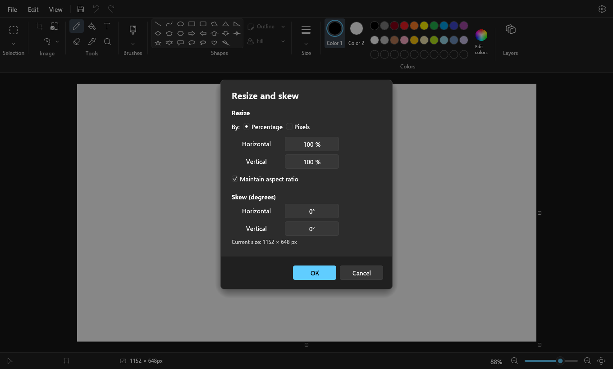

<!--
  OpenBrush
  Copyright © 2019 – 2026 The CipherOS Project (https://cipheros.org.in)
  Author: Aryan Sinha <techyminati>
  Licensed under the CipherOS License 2.0. See LICENSE for the full terms.
-->

<p align="center">
  
</p>

<h1 align="center">OpenBrush</h1>

<p align="center">
  A opensource paint program modelled on Windows 11/10 Paint. Runs on Windows, macOS and Linux.
</p>

<p align="center">
  <a href="https://github.com/techyminati/openbrush/releases/latest"></a>
  <a href="https://github.com/techyminati/openbrush/actions/workflows/ci.yml"></a>
</p>



OpenBrush looks and works like the Paint that comes with Windows 11/10, but it also runs on macOS and
Linux. If you've used Paint before, you already know how to use it. It's written in Rust on top of
[egui](https://github.com/emilk/egui).

## Download

Grab a build from the [latest release](https://github.com/techyminati/openbrush/releases/latest):

- **Windows** 10/11 (x64): [OpenBrush-windows-x86_64.zip](https://github.com/techyminati/openbrush/releases/latest/download/OpenBrush-windows-x86_64.zip).
  Unzip it and run `OpenBrush.exe`.
- **macOS** 11 or later (Apple Silicon and Intel): [OpenBrush-macos-universal.dmg](https://github.com/techyminati/openbrush/releases/latest/download/OpenBrush-macos-universal.dmg).
  Open it and drag OpenBrush into Applications.
- **Linux** (x86_64): [OpenBrush-linux-x86_64.tar.gz](https://github.com/techyminati/openbrush/releases/latest/download/OpenBrush-linux-x86_64.tar.gz).
  Extract it and run `./install.sh`, or just run `./openbrush` from the folder.

Every release has a `SHA256SUMS.txt` if you want to check your download.

The builds aren't code-signed, so your OS will probably complain the first time you open it. On Windows,
click "More info" and then "Run anyway" when SmartScreen shows up. On macOS, right-click the app and
pick Open.

## Features

Pretty much everything Paint has:

- Pencil, fill, text, eraser, color picker and magnifier
- 9 brushes (brush, calligraphy brush, calligraphy pen, airbrush, oil, crayon, marker, natural pencil
  and watercolor), each with its own texture
- All 23 shapes from Paint, with solid, crayon, marker, oil, natural pencil or watercolor outlines and
  fills. You can keep moving and resizing a shape after you draw it, until you click somewhere else.
- Rectangle and free-form selection, select all, invert, transparent selection, Ctrl-drag to
  duplicate, arrow keys to nudge, and cut/copy/paste that works with the system clipboard
- Crop, resize, skew, rotate and flip. You can also drag the edges of the canvas to resize it.
- Color 1 and Color 2, the usual Paint palette, custom colors and an Edit colors dialog with hex and RGB
- Layers: add, duplicate, delete, merge down, reorder, hide, opacity and 16 blend modes
- Text in any font you have installed, with bold, italic, underline, strikethrough, alignment and a
  background fill
- Opens and saves PNG, JPEG, BMP, GIF, TIFF, WebP and ICO. Recent files, drag and drop, import to
  canvas, printing and image properties are there too.
- Zoom from 1% to 800%, fit to window, rulers, gridlines, status bar, thumbnail and full screen
- Up to 200 undo steps, light and dark themes, and it remembers your settings. It also asks before
  closing if you have unsaved changes.

## Screenshots

| | |
|---|---|
|  |  |
| Light theme | Dark theme |
|  |  |
| Shapes | Moving a selection |
|  |  |
| Brushes menu | File menu |
|  |  |
| Edit colors | Resize and skew |

## Keyboard shortcuts

Mostly the same as Paint. On a Mac, use Cmd instead of Ctrl.

| Shortcut | What it does |
|----------|--------------|
| `Ctrl+N` | New |
| `Ctrl+O` | Open |
| `Ctrl+S` | Save |
| `F12` or `Ctrl+Shift+S` | Save as |
| `Ctrl+P` | Print |
| `Ctrl+E` | Image properties |
| `Ctrl+Z` | Undo |
| `Ctrl+Y` or `Ctrl+Shift+Z` | Redo |
| `Ctrl+X` / `Ctrl+C` / `Ctrl+V` | Cut / copy / paste |
| `Ctrl+A` | Select all |
| `Delete` | Delete the selection |
| `Ctrl+Shift+X` | Crop |
| `Ctrl+W` | Resize and skew |
| `Enter` or `Esc` | Finish the current shape, text or selection |
| `Ctrl+PgUp` / `Ctrl+PgDn` or `Ctrl` + scroll | Zoom in / out |
| `Ctrl+1` | Actual size |
| `Ctrl+0` | Fit to window |
| `Ctrl+Plus` / `Ctrl+Minus` | Brush size |
| `Ctrl+Shift+N` | New layer |
| `Ctrl+R` | Rulers |
| `Ctrl+G` | Gridlines |
| `F11` | Full screen |
| `Space` + drag, or middle mouse drag | Pan |
| Hold `Shift` while drawing | Constrain lines and shapes |

## Building it yourself

You'll need Rust 1.95 or newer. If you don't have it, get it from [rustup](https://rustup.rs). You
also need a C toolchain:

- **Windows**: the [Visual Studio Build Tools](https://visualstudio.microsoft.com/visual-cpp-build-tools/)
  with the "Desktop development with C++" workload
- **macOS**: the Xcode command line tools (`xcode-select --install`)
- **Linux**: a compiler plus the windowing libraries:

```sh
# Debian / Ubuntu
sudo apt install build-essential pkg-config libxkbcommon-dev libwayland-dev libx11-dev \
  libxcursor-dev libxrandr-dev libxi-dev libgl1-mesa-dev

# Fedora
sudo dnf install gcc pkg-config libxkbcommon-devel wayland-devel libX11-devel \
  libXcursor-devel libXrandr-devel libXi-devel mesa-libGL-devel

# Arch
sudo pacman -S base-devel pkgconf libxkbcommon wayland libx11 libxcursor libxrandr libxi mesa
```

Then clone and run it:

```sh
git clone https://github.com/techyminati/openbrush
cd openbrush
cargo run --release
```

On Linux the open and save dialogs go through the XDG desktop portal, which GNOME, KDE and most other
desktops already have. Printing on macOS and Linux uses CUPS.

### Making the release packages

If you want the same packages that go up on the releases page, run the script for your OS. The output
ends up in `dist/`.

```sh
pwsh packaging/windows/package.ps1   # OpenBrush-windows-x86_64.zip
packaging/macos/package.sh           # OpenBrush-macos-universal.dmg
packaging/linux/package.sh           # OpenBrush-linux-x86_64.tar.gz
```

## Tests

```sh
cargo test
```

Along with the engine's unit tests, this runs end-to-end tests that drive the actual app through
[egui_kittest](https://crates.io/crates/egui_kittest). They click toolbar buttons, draw on the canvas,
type text and press shortcuts the same way you would.

The screenshots in this README are rendered by the tests too. To regenerate them:

```sh
OPENBRUSH_SHOTS=docs/screenshots cargo test --test screenshot
```

There are also a few small programs in `examples/` for checking brushes, shapes, fonts and the app
icon, for example `cargo run --example brush_gallery -- brushes.png`.

## Code layout

- `src/engine/`: the image engine (layers, undo, brushes, shapes, fill, selections, transforms, text
  and file formats). It doesn't depend on the UI at all.
- `src/app/`: the app itself (tools, canvas, menus, toolbar, status bar, dialogs, layers panel and
  settings)
- `src/ui/`: the Windows 11 look (theme colors, fonts, icons, custom widgets and the app icon)
- `tests/`: end-to-end UI tests and the screenshot scenes
- `packaging/`: scripts that build the Windows, macOS and Linux packages
- `.github/workflows/`: CI and the release workflow

## Releasing

Bump the version in `Cargo.toml`, then tag it and push the tag:

```sh
git tag v1.0.0
git push origin v1.0.0
```

The [release workflow](.github/workflows/release.yml) checks that the tag matches `Cargo.toml`, runs
the tests on all three platforms, builds the packages and publishes them as a GitHub release.

## License

OpenBrush is released under the CipherOS License 2.0, see [LICENSE](LICENSE) for the full text.
Personal, evaluation, testing, security research and academic use is allowed. Commercial or
third-party distribution needs written permission from The CipherOS Project first
(<legal@cipheros.org.in>).

Third-party components keep their own licenses, listed in [THIRD_PARTY_NOTICES.md](THIRD_PARTY_NOTICES.md).
OpenBrush uses Microsoft's [Fluent UI System Icons](https://github.com/microsoft/fluentui-system-icons)
(MIT) and the [Selawik](https://github.com/microsoft/Selawik) font (OFL).

OpenBrush is an independent project. It isn't affiliated with or endorsed by Microsoft.

---

Made by Aryan Sinha ([@techyminati](https://github.com/techyminati)) as part of
[The CipherOS Project](https://cipheros.org.in).

© 2019-2026 The CipherOS Project. All Rights Reserved.
